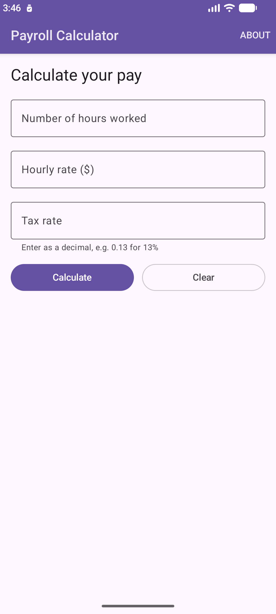
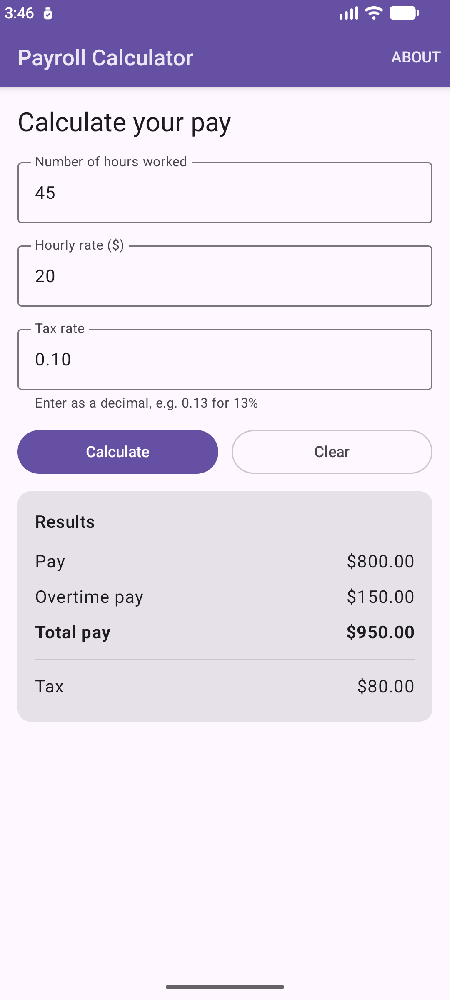
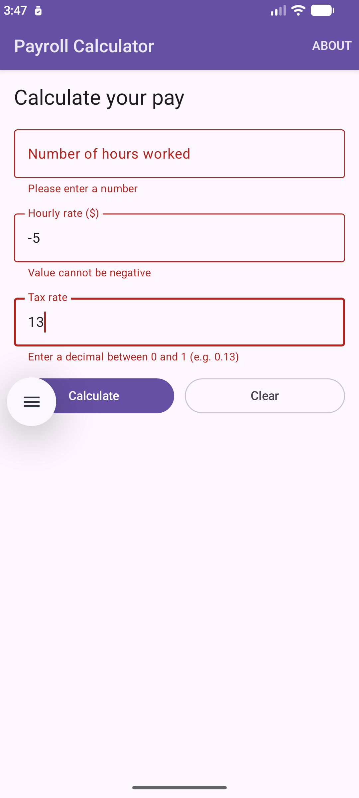
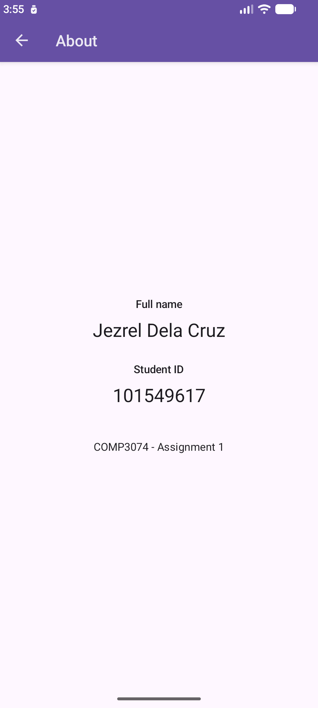

# Payroll Calculator — COMP3074 Assignment 1 (Fall 2026)

An Android app that calculates pay, overtime pay, total pay and tax from the hours worked, the hourly rate and the tax rate.

| | |
|---|---|
| **Student** | Jezrel Dela Cruz |
| **Student ID** | 101549617 |
| **Course** | COMP3074 – Mobile Application Development I |
| **Language / UI** | Kotlin, Jetpack Compose (Material 3) |
| **Min / Target SDK** | 25 (Android 7.1) / 37 |

---

## 1. Requirements checklist (mapped to the marking scheme)

| Marking item | Requirement | Where it is done | Status |
|---|---|---|---|
| **AboutActivity** (2) | Second activity shows full name (as per college record) and student ID | [AboutActivity.kt](app/src/main/java/com/delacruz/payrollcalculator/AboutActivity.kt), text in [strings.xml](app/src/main/res/values/strings.xml) | ✅ |
| **Navigation** (2) | About is opened from a button or menu | "About" item in MainActivity's ActionBar: [main_menu.xml](app/src/main/res/menu/main_menu.xml), [MainActivity.kt:64-76](app/src/main/java/com/delacruz/payrollcalculator/MainActivity.kt#L64-L76) | ✅ |
| | Back button in the ActionBar of AboutActivity | `actionBar?.setDisplayHomeAsUpEnabled(true)` at [AboutActivity.kt:31](app/src/main/java/com/delacruz/payrollcalculator/AboutActivity.kt#L31) | ✅ |
| | Back goes to MainActivity **without** creating a new instance | `finish()` at [AboutActivity.kt:43-51](app/src/main/java/com/delacruz/payrollcalculator/AboutActivity.kt#L43-L51), plus `parentActivityName` and `launchMode="singleTop"` in [AndroidManifest.xml](app/src/main/AndroidManifest.xml) | ✅ verified on emulator (section 6) |
| **Input** (2) | Read hours worked, hourly rate, tax rate | Three `OutlinedTextField`s with a decimal keyboard: [MainActivity.kt:171-193](app/src/main/java/com/delacruz/payrollcalculator/MainActivity.kt#L171-L193) | ✅ |
| **Calculation** (2) | Pay / overtime / total pay / tax formulas | [PayrollCalculator.kt:32](app/src/main/java/com/delacruz/payrollcalculator/PayrollCalculator.kt#L32) | ✅ 6 unit tests pass |
| **Output** (2) | Show pay, overtime pay, total pay, tax | `ResultCard` at [MainActivity.kt:242](app/src/main/java/com/delacruz/payrollcalculator/MainActivity.kt#L242) | ✅ |

---

## 2. Project structure

```
app/src/main/
├── AndroidManifest.xml                 # declares both activities, singleTop + parentActivityName
├── java/com/delacruz/payrollcalculator/
│   ├── MainActivity.kt                 # input form, Calculate/Clear buttons, results, About menu
│   ├── AboutActivity.kt                # name + student ID, ActionBar back arrow
│   ├── PayrollCalculator.kt            # the formulas (pure Kotlin, no Android code)
│   └── ui/theme/                       # Compose colours, typography, theme
└── res/
    ├── menu/main_menu.xml              # the "About" ActionBar item
    ├── values/strings.xml              # all text, including name and student ID
    ├── values/themes.xml               # DarkActionBar theme so both screens have an ActionBar
    └── values/colors.xml               # ActionBar colour

app/src/test/java/com/delacruz/payrollcalculator/
└── PayrollCalculatorTest.kt            # unit tests for the formulas
```

---

## 3. How everything works

### 3.1 App start-up

1. Android reads [AndroidManifest.xml](app/src/main/AndroidManifest.xml). `MainActivity` has the `MAIN` / `LAUNCHER` intent filter, so it is the first screen.
2. The app theme `Theme.PayrollCalculator` extends `android:Theme.Material.Light.DarkActionBar`. This gives every activity a real **ActionBar** (the purple bar at the top). The screen content is drawn below it with Jetpack Compose.
3. `MainActivity.onCreate()` calls `setContent { PayrollScreen() }`, which draws the form.

### 3.2 Input (MainActivity)

`PayrollScreen()` keeps what the user types in three state variables:

```kotlin
var hoursText by rememberSaveable { mutableStateOf("") }
var rateText by rememberSaveable { mutableStateOf("") }
var taxRateText by rememberSaveable { mutableStateOf("") }
```

- Each value is shown in an `OutlinedTextField` (the `NumberField` helper).
- `KeyboardType.Decimal` opens a number keyboard with a decimal point.
- The first two fields use the **Next** key to jump to the next field. The tax-rate field uses **Done**, which runs the calculation.
- `rememberSaveable` keeps the values when the screen rotates. Android destroys and recreates the activity on rotation; without this the fields would be emptied.
- The tax rate is entered as a decimal, e.g. `0.13` for 13%. A hint under the field says this.

### 3.3 Validation

When **Calculate** is tapped, `calculate()` ([MainActivity.kt:112](app/src/main/java/com/delacruz/payrollcalculator/MainActivity.kt#L112)) does three steps:

1. **Read.** `toDoubleOrNull()` turns the text into a number. It returns `null` for empty or non-numeric text instead of crashing the app.
2. **Validate** each field and save an error message for it:

| Field | Rule | Error shown |
|---|---|---|
| Hours worked | must be a number, ≥ 0 | "Please enter a number" / "Value cannot be negative" |
| Hourly rate | must be a number, ≥ 0 | "Please enter a number" / "Value cannot be negative" |
| Tax rate | must be a number between 0 and 1 | "Please enter a number" / "Enter a decimal between 0 and 1 (e.g. 0.13)" |

3. **Calculate** only when all three are valid. Otherwise each bad field turns red and shows its message.

### 3.4 Calculation

The formulas live in [PayrollCalculator.kt](app/src/main/java/com/delacruz/payrollcalculator/PayrollCalculator.kt), separate from the UI, so they can be unit tested on their own:

```kotlin
if (hours <= REGULAR_HOURS) {                 // REGULAR_HOURS = 40.0
    pay = hours * hourlyRate
    overtimePay = 0.0
} else {
    pay = REGULAR_HOURS * hourlyRate
    overtimePay = (hours - REGULAR_HOURS) * hourlyRate * OVERTIME_MULTIPLIER   // 1.5
}
val totalPay = pay + overtimePay
val tax = pay * taxRate
```

This follows the assignment exactly:

| Assignment formula | Code |
|---|---|
| if hours ≤ 40: `pay = no_of_hours * hourly_rate`, `overtime_pay = 0` | `if (hours <= REGULAR_HOURS)` branch |
| else: `pay = 40 * hourly_rate` | `pay = REGULAR_HOURS * hourlyRate` |
| else: `overtime_pay = (no_of_hours - 40) * hourly_rate * 1.5` | `(hours - REGULAR_HOURS) * hourlyRate * OVERTIME_MULTIPLIER` |
| `total_pay = pay + overtime_pay` | `val totalPay = pay + overtimePay` |
| `tax = pay * tax_rate` | `val tax = pay * taxRate` |

> **Note:** the assignment calculates tax on **pay** (regular pay), not on total pay. The app does the same. For example, 45 h at $20 with a 0.10 tax rate gives tax = 800 × 0.10 = **$80**, not 950 × 0.10.

Exactly 40 hours counts as "less or equal than 40", so it has **no** overtime.

The function returns a `PayResult(pay, overtimePay, totalPay, tax)` data class.

### 3.5 Output

- The result is stored in `var result by rememberSaveable(stateSaver = PayResultSaver) { mutableStateOf(null) }`.
- `null` means nothing has been calculated yet, so the results card is hidden. After a valid calculation, `result?.let { ResultCard(it) }` shows the card.
- `ResultCard` lists **Pay**, **Overtime pay**, **Total pay** (bold) and **Tax**.
- `formatMoney()` formats each amount as Canadian dollars with two decimals, e.g. `$1,234.50`.
- `PayResultSaver` turns the result into a list of four numbers, so it also survives rotation.
- **Clear** empties the fields, the errors and the results.

### 3.6 Opening the About screen (menu in the ActionBar)

1. `onCreateOptionsMenu()` inflates [main_menu.xml](app/src/main/res/menu/main_menu.xml). It has one item, `action_about`, with `showAsAction="always"`, so **ABOUT** appears in the ActionBar.
2. Tapping it calls `onOptionsItemSelected()`, which starts the About screen with an explicit intent:

```kotlin
if (item.itemId == R.id.action_about) {
    startActivity(Intent(this, AboutActivity::class.java))
    return true
}
```

### 3.7 AboutActivity and the ActionBar back button

```kotlin
// onCreate
actionBar?.setDisplayHomeAsUpEnabled(true)     // shows the ← arrow in the ActionBar

override fun onOptionsItemSelected(item: MenuItem): Boolean {
    if (item.itemId == android.R.id.home) {    // the ← arrow has the id android.R.id.home
        finish()
        return true
    }
    return super.onOptionsItemSelected(item)
}
```

`AboutScreen()` shows the full name and student ID from `strings.xml` (`student_full_name`, `student_id`).

### 3.8 Why no new MainActivity is created

Android keeps activities in a **back stack**:

```
After launch:          [ MainActivity ]
After tapping About:   [ MainActivity, AboutActivity ]   ← MainActivity is stopped, NOT destroyed
After tapping ←:       [ MainActivity ]                  ← same object, resumed
```

- **`finish()`** removes AboutActivity from the top of the stack. Android then shows the MainActivity that is already underneath. No `Intent` to MainActivity is sent, so no new instance can be created. Because it is the same instance, the typed values and results are still on screen.
- **`android:parentActivityName=".MainActivity"`** (manifest) tells Android that MainActivity is the logical parent of AboutActivity.
- **`android:launchMode="singleTop"`** (manifest) is a safety net. If the system's own "Up" handling ever sends an intent to MainActivity while it is on top, Android reuses the existing instance instead of making a new one.

The phone's hardware/gesture **Back** works the same way: it also finishes AboutActivity.

---

## 4. Worked examples

| Hours | Rate | Tax rate | Pay | Overtime pay | Total pay | Tax |
|---|---|---|---|---|---|---|
| 30 | 20.00 | 0.10 | 600.00 | 0.00 | 600.00 | 60.00 |
| 40 | 15.00 | 0.13 | 600.00 | 0.00 | 600.00 | 78.00 |
| 45 | 20.00 | 0.10 | 800.00 | 150.00 | 950.00 | 80.00 |
| 40.5 | 10.00 | 0.20 | 400.00 | 7.50 | 407.50 | 80.00 |
| 0 | 25.00 | 0.15 | 0.00 | 0.00 | 0.00 | 0.00 |

Example for 45 h: pay = 40 × 20 = 800; overtime = (45 − 40) × 20 × 1.5 = 150; total = 800 + 150 = 950; tax = 800 × 0.10 = 80.

---

## 5. How to run

**Android Studio**
1. Open the project folder in Android Studio.
2. Let Gradle sync finish.
3. Pick an emulator or a phone and press **Run ▶**.

**Command line (Windows)**
```bash
gradlew.bat assembleDebug
```
```bash
gradlew.bat testDebugUnitTest
```
The APK is created at `app/build/outputs/apk/debug/app-debug.apk`.

---

## 6. Testing and verification

### 6.1 Unit tests — `PayrollCalculatorTest` (6/6 pass)

| Test | Checks |
|---|---|
| `under40Hours_noOvertime` | 30 h × $20 → pay 600, overtime 0, total 600, tax 60 |
| `exactly40Hours_noOvertime` | 40 h is not overtime → pay 600, overtime 0, tax 78 |
| `over40Hours_overtimeAtTimeAndAHalf` | 45 h × $20 → pay 800, overtime 150, total 950 |
| `taxIsCalculatedOnPay_notOnTotalPay` | tax = 800 × 0.10 = 80 (not 95) |
| `fractionalOvertimeHours` | 40.5 h × $10 → overtime 7.50 |
| `zeroHours_everythingIsZero` | 0 h → everything 0 |

### 6.2 Manual tests on the emulator (Medium Phone, Android API 37)

| # | Test | Expected | Result |
|---|---|---|---|
| 1 | Launch app | Form with ActionBar and **ABOUT** item | ✅ |
| 2 | 45 h, $20, 0.10 → Calculate | $800.00 / $150.00 / $950.00 / tax $80.00 | ✅ |
| 3 | 40 h, $15, 0.13 → keyboard Done | $600.00 / $0.00 / $600.00 / tax $78.00 | ✅ |
| 4 | Empty hours, rate −5, tax 13 → Calculate | Red errors under each field, no crash, no results | ✅ |
| 5 | Tap **ABOUT** | About screen with name, student ID and ← arrow | ✅ |
| 6 | Tap ← in the ActionBar | Back on the **same** MainActivity; typed values and results still shown | ✅ |
| 7 | Open About, press phone **Back** | Same as test 6 | ✅ |
| 8 | Rotate to landscape and back | Inputs and results kept | ✅ |
| 9 | Crash log (`adb logcat -b crash`) | No crashes | ✅ |

**Proof for test 6** (from `adb shell dumpsys activity activities` and the `events` log):

- Before About: one record, `MainActivity` #137897983.
- On About: `MainActivity` #137897983 and `AboutActivity` on top.
- After ←: `AboutActivity` finished (`app-request`). The same `MainActivity` #137897983 received `onRestart → onStart → onResume`, with **no** new `onCreate`. Only one MainActivity was ever in the stack.

### 6.3 Build checks

- `assembleDebug` → BUILD SUCCESSFUL
- `testDebugUnitTest` → 6 tests, 0 failures
- `lintDebug` → no code warnings. The only remaining notices are that newer library versions exist; the versions are left as Android Studio created them.

---

## 7. Screenshots

| Main screen | Results | Validation | About |
|---|---|---|---|
|  |  |  |  |

---

## 8. Progress log

| Date | Step |
|---|---|
| 2026-10-15 | Created the project in Android Studio ("Empty Activity", Kotlin + Compose), package `com.delacruz.payrollcalculator`. |
| 2026-10-16 | Read the assignment and mapped each requirement to the marking scheme (section 1). Confirmed the starter project builds. |
| 2026-10-16 | Wrote `PayrollCalculator.kt` with the exact formulas, and `PayrollCalculatorTest.kt` (6 tests). Replaced the template's example unit test. |
| 2026-10-16 | Built the MainActivity screen: three decimal inputs, validation, Calculate / Clear buttons, results card, state kept on rotation. |
| 2026-10-16 | Changed the theme to `DarkActionBar` so the app has an ActionBar. Added the **About** menu item. |
| 2026-10-16 | Added `AboutActivity` (name + student ID), the ActionBar back arrow with `finish()`, `parentActivityName`, and `singleTop` on MainActivity. |
| 2026-10-16 | Removed unused template colours and a redundant manifest label flagged by lint. |
| 2026-10-16 | Ran the build, unit tests and lint. Tested every flow on the emulator, including proof that ← reuses the same MainActivity (section 6). |
| 2026-10-16 | Wrote this README and pushed the project to GitHub. |

---

## 9. Possible interview questions (quick answers)

**How do you open AboutActivity?**
`onCreateOptionsMenu` inflates `main_menu.xml` into the ActionBar. When the item is tapped, `onOptionsItemSelected` checks `R.id.action_about` and calls `startActivity(Intent(this, AboutActivity::class.java))`.

**How does the back arrow work, and why is no new MainActivity created?**
`setDisplayHomeAsUpEnabled(true)` shows the arrow. Its id is `android.R.id.home`. On tap, `finish()` closes AboutActivity, and Android shows the MainActivity that was already in the back stack. No intent to MainActivity is sent. `singleTop` in the manifest is an extra safety net.

**How do you read the input safely?**
`toDoubleOrNull()` returns `null` instead of throwing an exception. Each field is checked (number, not negative, tax rate between 0 and 1), and errors are shown under the field.

**Where is the calculation and how does it handle overtime?**
`PayrollCalculator.calculate()`. If hours ≤ 40, pay = hours × rate and overtime is 0. Otherwise pay = 40 × rate and overtime = (hours − 40) × rate × 1.5. Total = pay + overtime. Tax = pay × tax rate.

**Why `rememberSaveable` instead of `remember`?**
Rotating the phone destroys and recreates the activity. `remember` would lose the values; `rememberSaveable` saves them in the saved-instance-state bundle and restores them.

**How is the output shown?**
`result` is `null` until a valid calculation. Then `ResultCard` shows the four values, formatted with `NumberFormat.getCurrencyInstance(Locale.CANADA)`.
